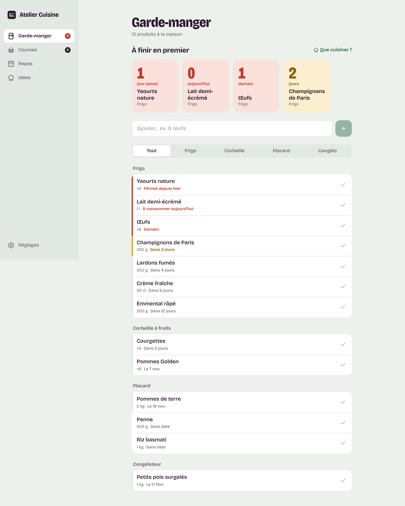

# Atelier Cuisine

Liste de courses, suivi des repas, idées de plats selon ce qu'il reste à la maison, et alertes avant les dates de péremption. Une seule app, sur **Mac** (app à double-cliquer) et sur **iPhone** (app sur l'écran d'accueil), synchronisée en direct.



## Ce que fait l'app

| Écran | |
|---|---|
| **Garde-manger** | Ce qu'il y a dans le frigo, la corbeille, le placard et le congélateur. En haut, « À finir en premier » affiche un compte à rebours pour chaque produit qui arrive à échéance. La saisie « 6 œufs » ou « 500 g de lardons » devine le rayon, l'emplacement et une date de péremption, à corriger si besoin. |
| **Courses** | Liste rangée dans l'ordre des rayons. On coche en magasin, puis **Ranger les achats** les fait passer dans le garde-manger avec une date estimée pour chacun. La liste se partage par Messages ou se copie. |
| **Repas** | Journal de la semaine : petit-déjeuner, déjeuner, goûter, dîner. Un repas noté depuis une recette retire les ingrédients utilisés du garde-manger. |
| **Idées** | 34 recettes du quotidien, classées selon ce qui est à la maison, en commençant par ce qui périme. **Ajouter le manquant** remplit la liste de courses, **Je cuisine ça** note le repas. On peut ajouter ses propres recettes. |
| **Alertes** | Pastille sur l'onglet et sur l'icône, notification à l'ouverture de l'app Mac, et rappel chaque matin sur l'iPhone, même app fermée. Le délai (1 à 7 jours) se règle dans Réglages. |

## Installer

### Sur Mac

1. Va dans [Releases → Atelier Cuisine pour Mac](../../releases/tag/mac-latest) et télécharge **Atelier-Cuisine.dmg**.
2. Ouvre le .dmg et glisse **Atelier Cuisine** dans **Applications**.
3. Premier lancement : l'app n'est pas signée par un compte développeur Apple, donc macOS la bloque. Double-clique dessus une fois, puis va dans **Réglages Système → Confidentialité et sécurité** et clique **Ouvrir quand même**. Ensuite, elle s'ouvre normalement par double-clic.
   Alternative dans le Terminal : `xattr -cr "/Applications/Atelier Cuisine.app"`.

L'app Mac est recompilée automatiquement par GitHub Actions à chaque modification du dossier `frontend/` (workflow « App Mac », environ 5 minutes).

### Sur iPhone

1. Ouvre **https://atelier-cuisine-iota.vercel.app** dans **Safari**.
2. Touche **Partager**, puis **Sur l'écran d'accueil**, puis **Ajouter**.
3. Ouvre l'app depuis son icône, connecte-toi, puis dans **Réglages → Alertes**, touche **Activer** pour recevoir les rappels de péremption. Il faut iOS 16.4 ou plus récent.

Le même compte sur les deux appareils partage tout en temps réel.

L'app web est hébergée sur Vercel (équipe FiKozZ, projet `atelier-cuisine`). Pour qu'elle se mette à jour à chaque push, connecte GitHub à Vercel une fois : **vercel.com → projet atelier-cuisine → Settings → Git → Connect Git Repository → Atelier_Cuisine**, avec `frontend` comme dossier racine.

## Architecture

```
┌─────────────────────────┐      ┌──────────────────────────────────────┐
│ frontend/  (React)      │      │ backend/  (Supabase, Paris)          │
│                         │      │                                      │
│  App Mac  ── Tauri .dmg ├──┐   │  Postgres + RLS                      │
│  iPhone   ── PWA Vercel ├──┼──▶│  Auth (e-mail + mot de passe)        │
│  Navigateur             ├──┘   │  Realtime (synchro Mac ↔ iPhone)     │
└─────────────────────────┘      │  suggest_recipes(), rangement…       │
                                 │  Edge Function alertes-peremption ◀─ pg_cron (chaque matin)
design/  jetons, guide, icône,   │        └─▶ Web Push vers l'iPhone    │
         captures                └──────────────────────────────────────┘
```

| Dossier | Contenu |
|---|---|
| [`frontend/`](frontend/) | React 19 + TypeScript + Vite. PWA (service worker, manifeste, notifications push). `src-tauri/` enveloppe le même code en app Mac native. |
| [`backend/`](backend/) | Migrations SQL, catalogue de recettes, fonction Edge des alertes. Voir [backend/README.md](backend/README.md). |
| [`design/`](design/) | Guide de design, palette, typographie, icône, captures. Voir [design/DESIGN.md](design/DESIGN.md). |
| [`.github/workflows/`](.github/workflows/) | Compilation de l'app Mac (Intel + Apple Silicon) et publication du .dmg. |

## Développer

```bash
cd frontend
npm install
npm run dev          # app web sur http://localhost:1420
npm run tauri dev    # app Mac en développement (sur un Mac, avec Rust installé)
npm run mac          # compile le .dmg localement (sur un Mac)
```

La configuration Supabase est intégrée par défaut. Pour utiliser un autre projet, copie `frontend/.env.example` en `.env.local`.

## Réglage conseillé (une fois)

Dans Supabase, **Authentication → URL Configuration**, mets **Site URL** = `https://atelier-cuisine-iota.vercel.app` et ajoute la même adresse dans **Redirect URLs**. Les liens des e-mails de confirmation ramènent alors directement dans l'app.
