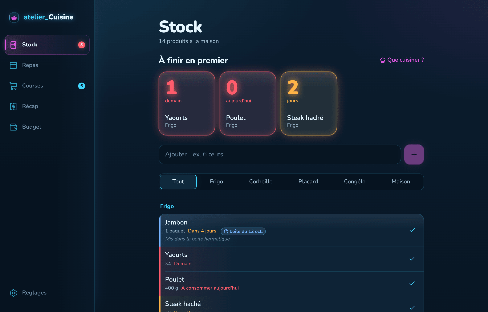

# atelier_Cuisine

L'app de cuisine du foyer d'Auré et François : le stock du frigo et des placards avec les dates de péremption, le semainier des repas, la liste de courses, les tickets de caisse archivés et le budget. Une seule app, sur **Mac** (app à double-cliquer) et sur **iPhone** (app sur l'écran d'accueil), synchronisée en direct, au style néon holographique des apps atelier_.



## Ce que fait l'app

| Onglet | |
|---|---|
| **Stock** | Ce qu'il y a dans le frigo, la corbeille, le placard, le congélateur et la salle de bain. « À finir en premier » affiche un compte à rebours lumineux pour chaque produit qui arrive à échéance. Chaque produit a une quantité exacte **ou** un niveau rapide (plein, moitié, assez pour 1 repas, presque fini), une date d'emballage, une date de **mise en boîte** (badge bleu) et une note libre. La saisie « 6 œufs » devine le produit du catalogue, le rayon, l'emplacement et une date. |
| **Repas** | Semainier Lundi → Dimanche (ou focus week-end), Midi et Soir. Trois types de repas : **recette** (déduit les quantités), **assemblage rapide** (Burger frites, Saumon riz… déduit les produits) et **extérieur** (resto, MacDo : rien n'est déduit, le coût va dans Sorties / Resto). Les favoris du foyer sont proposés en un geste. **Cuisiner ce repas** déduit le stock en prenant d'abord ce qui périme le plus tôt. Les idées de plats selon le stock sont dans le même onglet. |
| **Courses** | Liste rangée selon les 11 rayons du foyer. Un bouton ajoute ce qui manque pour les repas prévus (besoins − stock − déjà sur la liste). En **mode magasin**, cocher un article permet de noter son prix et sa date. **Valider & archiver** crée le ticket dans Récap, fait entrer l'alimentaire dans le stock et alimente le budget. |
| **Récap** | Bilan du dernier panier (total, articles, Alimentaire / Maison & hygiène, les 3 plus chers) et historique des tickets, dépliables par rayon. **Importer un ticket** : e-ticket PDF, photo ou texte. Le format Carrefour est lu sans IA ; sinon l'IA (Ollama en local ou Claude) décode le ticket, puis une fenêtre de vérification permet de corriger avant de confirmer. **Reprendre des articles** renvoie des produits vers la liste ; **Markdown** copie le récapitulatif. |
| **Budget** | Plafonds par semaine ou par mois pour l'Alimentaire, la Maison & hygiène, les Sorties / Resto et le global. Panier moyen, coût par repas cuisiné, six mois de dépenses et l'évolution du prix de chaque produit d'un ticket à l'autre. |
| **Alertes** | Pastille sur l'onglet et sur l'icône, notification à l'ouverture de l'app Mac, et rappel chaque matin sur l'iPhone, même app fermée. Le délai (1 à 7 jours) se règle dans Réglages. |

Les données du foyer (11 rayons, 152 produits habituels, 15 repas favoris, recettes Nouilles sautées crevettes, Gaufres et Crêpes) viennent de [`CONTEXT_SPEC.md`](CONTEXT_SPEC.md) et sont chargées par les migrations. **Réglages → Données d'exemple** ajoute aussi la boîte de jambon, les niveaux de stock notés et les pâtes à racheter.

## Installer

### Sur Mac

1. Va dans [Releases → Atelier Cuisine pour Mac](../../releases/tag/mac-latest) et télécharge **Atelier-Cuisine.dmg**.
2. Ouvre le .dmg et glisse **Atelier Cuisine** dans **Applications**.
3. Premier lancement : l'app n'est pas signée par un compte développeur Apple, donc macOS la bloque. Double-clique dessus une fois, puis va dans **Réglages Système → Confidentialité et sécurité** et clique **Ouvrir quand même**. Ensuite, elle s'ouvre normalement par double-clic.
   Alternative dans le Terminal : `xattr -cr "/Applications/Atelier Cuisine.app"`.

L'app Mac est recompilée automatiquement par GitHub Actions à chaque modification du dossier `frontend/` sur `main` (workflow « App Mac », environ 5 minutes).

### Sur iPhone

1. Ouvre **https://atelier-cuisine-iota.vercel.app** dans **Safari**.
2. Touche **Partager**, puis **Sur l'écran d'accueil**, puis **Ajouter**.
3. Ouvre l'app depuis son icône, connecte-toi, puis dans **Réglages → Alertes**, touche **Activer** pour recevoir les rappels de péremption. Il faut iOS 16.4 ou plus récent.

Le même compte sur les deux appareils partage tout en temps réel.

L'app web est hébergée sur Vercel (équipe FiKozZ, projet `atelier-cuisine`). Pour qu'elle se mette à jour à chaque push, connecte GitHub à Vercel une fois : **vercel.com → projet atelier-cuisine → Settings → Git → Connect Git Repository → Atelier_Cuisine**, avec `frontend` comme dossier racine.

## Architecture

```
┌──────────────────────────────┐      ┌──────────────────────────────────────────┐
│ frontend/  (React)           │      │ backend/  (Supabase, Paris)              │
│                              │      │                                          │
│  App Mac  ── Tauri .dmg      ├──┐   │  Postgres + RLS : stock, planning,       │
│  iPhone   ── PWA Vercel      ├──┼──▶│    courses, tickets, budget, catalogue   │
│  Navigateur                  ├──┘   │  Auth · Realtime (synchro Mac ↔ iPhone)  │
│                              │      │  archiver_courses(), cuisiner_repas()…   │
│  Lecture des tickets :       │      │  Edge Function lire-ticket ──▶ Claude    │
│   PDF → texte (pdf.js)       │      │  Edge Function alertes-peremption        │
│   Carrefour → décodé sans IA │      │        ◀─ pg_cron (chaque matin)         │
│   sinon → Ollama (Mac) ──────┼──▶ http://localhost:11434 (mode local)         │
│        ou Claude (cloud) ────┼──────┘                                          │
└──────────────────────────────┘      └──────────────────────────────────────────┘
design/  charte néon, jetons, guide, icône, captures
```

| Dossier | Contenu |
|---|---|
| [`frontend/`](frontend/) | React 19 + TypeScript + Vite. PWA (service worker, manifeste, notifications push). `src-tauri/` enveloppe le même code en app Mac native. La logique métier testée est dans `src/lib/` (stock FEFO, tickets, budget). |
| [`backend/`](backend/) | Migrations SQL, catalogues (recettes, produits, favoris), fonctions Edge, tests des migrations. Voir [backend/README.md](backend/README.md). |
| [`design/`](design/) | Guide de design néon, palette, typographie, icône, captures. Voir [design/DESIGN.md](design/DESIGN.md). |
| [`CONTEXT_SPEC.md`](CONTEXT_SPEC.md) | Cahier des charges du foyer : habitudes, 5 onglets, référentiel, recettes, format des tickets. |
| [`.github/workflows/`](.github/workflows/) | Compilation de l'app Mac (Intel + Apple Silicon) et publication du .dmg. |

## Lecture des tickets par l'IA

Dans **Réglages → Lecture des tickets par l'IA** :

- **Auto** (par défaut) : Ollama s'il répond en moins de 3 secondes, sinon Claude.
- **Local** : Ollama sur le Mac, hors ligne et gratuit. Installe [Ollama](https://ollama.com), puis `ollama pull llama3.2` (texte) et `ollama pull llama3.2-vision` (photos). L'app Mac l'atteint directement ; depuis un navigateur, lance Ollama avec `OLLAMA_ORIGINS` autorisant l'adresse de l'app.
- **Cloud** : Claude, via la fonction `lire-ticket` ; fonctionne partout, iPhone compris. La clé API reste dans les secrets Supabase, jamais dans l'app.

Si le moteur choisi ne répond pas, l'app le dit et propose de basculer sur l'autre.

## Développer

```bash
cd frontend
npm install
npm run dev          # app web sur http://localhost:1420
npm test             # tests de la logique (tickets, stock FEFO, budget)
npm run tauri dev    # app Mac en développement (sur un Mac, avec Rust installé)
npm run mac          # compile le .dmg localement (sur un Mac)

cd ../backend/tests
npm install && npm test   # rejoue toutes les migrations sur un Postgres local (PGlite)
```

La configuration Supabase est intégrée par défaut. Pour utiliser un autre projet, copie `frontend/.env.example` en `.env.local`.

## Mettre à jour le backend (une fois, avant de publier le frontend)

Les nouvelles fonctions de l'app ont besoin des migrations du 21/10/2026. À appliquer **avant** de fusionner sur `main` (qui recompile l'app Mac et met à jour le site) :

```bash
supabase link --project-ref hcdiuxznceuixindcvhp
supabase db push                                   # 7 nouvelles migrations
supabase secrets set ANTHROPIC_API_KEY=sk-ant-...  # mode Cloud de lecture des tickets
supabase functions deploy lire-ticket
```

Le secret facultatif `ANTHROPIC_MODEL` choisit le modèle (par défaut `claude-sonnet-5-5`).

## Réglage conseillé (une fois)

Dans Supabase, **Authentication → URL Configuration**, mets **Site URL** = `https://atelier-cuisine-iota.vercel.app` et ajoute la même adresse dans **Redirect URLs**. Les liens des e-mails de confirmation ramènent alors directement dans l'app.
