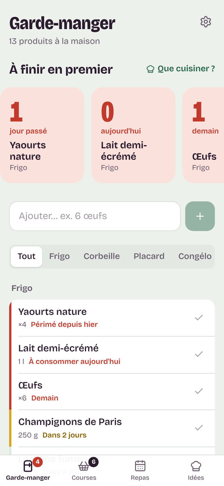
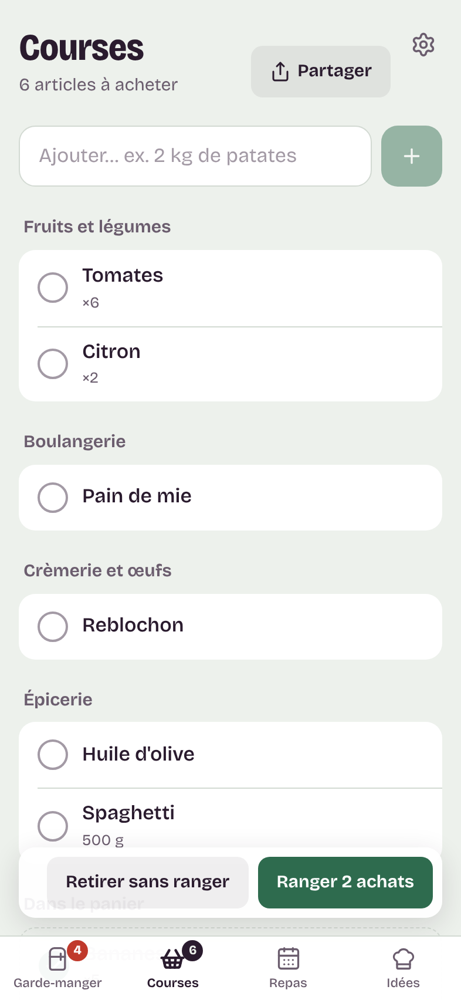
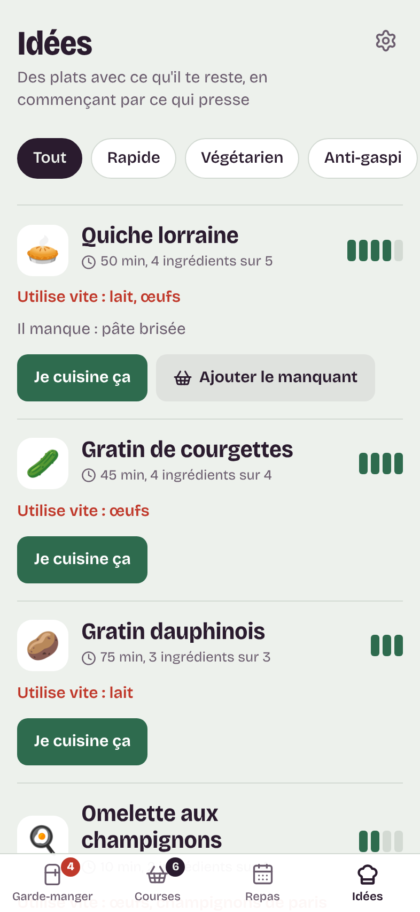
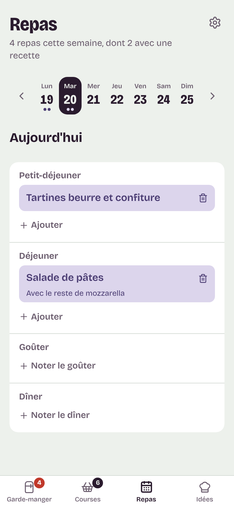
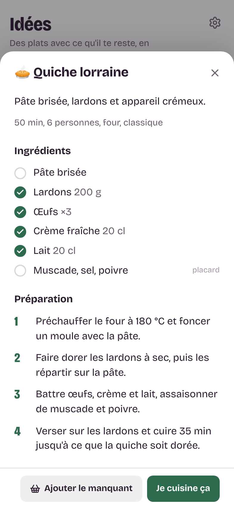
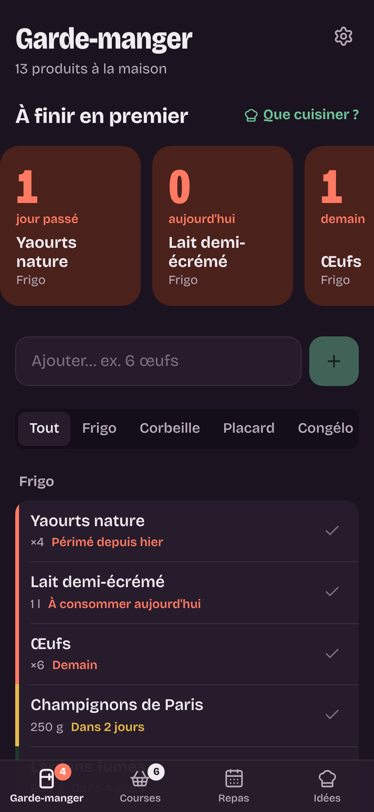
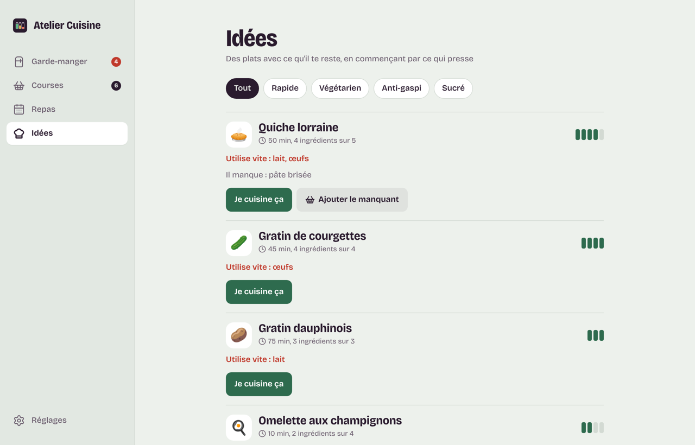

# Atelier Cuisine — design UI

Une app de cuisine domestique : on y note ce qu'il y a dans le frigo, ce qu'il faut acheter, ce qu'on a mangé, et elle propose quoi cuisiner en commençant par ce qui presse.

**Tâche principale de l'interface :** montrer d'un coup d'œil ce qu'il faut finir en premier.

## Direction : faïence & aubergine

Plutôt que le crème + terracotta des apps de recettes, la palette part du carrelage d'une cuisine (céladon pâle) et d'une encre aubergine. Les trois couleurs d'état viennent du marché et racontent la fraîcheur : **basilic** (frais) → **moutarde** (bientôt) → **tomate** (aujourd'hui ou périmé).

| Jeton | Clair | Sombre | Rôle |
|---|---|---|---|
| `--faience` | `#EDF1EC` | `#1B1320` | fond de l'app |
| `--porcelaine` | `#FFFFFF` | `#261C2B` | surfaces, listes |
| `--aubergine` | `#2A1B2E` | `#F1ECF2` | encre |
| `--basilic` | `#2E6B4E` | `#6FC59A` | frais, actions principales |
| `--moutarde` | `#8A6100` (texte) / `#D9A520` (barre) | `#E7B94A` | bientôt |
| `--tomate` | `#C0392B` | `#FF7A63` | aujourd'hui, périmé |
| `--lavande` | `#DCD5EC` | `#3A3152` | repas notés |

Les jetons complets sont dans [`frontend/src/styles/tokens.css`](../frontend/src/styles/tokens.css), qui est la source de vérité.

## Typographie

Une seule famille, **Bricolage Grotesque** (variable, axes graisse, largeur et taille optique), embarquée dans l'app pour fonctionner hors ligne sur Mac.

- Titres d'écran : 32 px (44 px sur Mac), graisse 780, largeur 86 %.
- Corps : 17 px, la taille de référence iOS. Les champs restent à 17 px pour éviter le zoom automatique de Safari.
- **Compte à rebours** : chiffres de 52 px, graisse 800, largeur 75 %, chiffres tabulaires.

## L'élément signature : le compte à rebours de fraîcheur

En haut du garde-manger, la bande **« À finir en premier »** montre chaque produit urgent sous forme de tuile avec le nombre de jours restants en très grand, dans la couleur de son état. C'est le seul endroit où l'interface « crie » ; le reste reste calme :

- chaque ligne de produit porte une **barre de fraîcheur** de 4 px à gauche (tomate, moutarde ou basilic pâle) ;
- les libellés d'échéance reprennent la même couleur (« À consommer aujourd'hui », « Dans 2 jours ») ;
- les idées de plats affichent une **jauge** d'ingrédients disponibles et une ligne « Utilise vite : … » en tomate.

## Mise en page

```
iPhone                         Mac
┌──────────────────┐           ┌────────────┬──────────────────────────┐
│ Titre        ⚙   │           │ ▮▮▮ Atelier│ Titre                    │
│ À finir en 1er   │           │  Cuisine   │ À finir en premier       │
│ [1][0][1][2]→    │           │            │ [1][0][1][2]             │
│ [Ajouter…]   [+] │           │ Garde-m. 4 │ [Ajouter…]           [+] │
│ Tout|Frigo|…     │           │ Courses  6 │ Tout | Frigo | …         │
│ ▌Yaourts         │           │ Repas      │ ▌Yaourts                 │
│ ▌Lait            │           │ Idées      │ ▌Lait                    │
│ ...              │           │            │ ...                      │
├──────────────────┤           │ Réglages   │                          │
│ 🧊  🧺  📅  👨‍🍳 │           └────────────┴──────────────────────────┘
└──────────────────┘
```

- **iPhone** : onglets en bas (zone de sécurité respectée), réglages en haut à droite, modales qui montent du bas.
- **Mac** (≥ 860 px) : barre latérale de 248 px, contenu centré sur 760 px, modales centrées. Dans l'app Mac, la barre de titre est intégrée (boutons de fenêtre au-dessus de la barre latérale).
- Les listes sont groupées (par emplacement ou par rayon) dans des blocs blancs, pas en cartes identiques ; les rayons suivent l'ordre d'un supermarché.
- Rayons hiérarchiques : pastilles 999 px, tuiles 20 px, groupes 14 px, champs 10 px.

## Principes

1. **Ce qui presse d'abord.** Tri par date partout, couleur d'état cohérente, alertes à la même place.
2. **Saisie en une ligne.** « 2 kg de pommes de terre » donne quantité, unité, rayon, emplacement et date estimée ; on corrige ensuite si besoin.
3. **Chaque action dit ce qu'elle fait.** « Ranger 3 achats », « Je cuisine ça », « Ajouter le manquant », et le toast reprend le même verbe, avec « Annuler » quand on retire quelque chose.
4. **Les états vides guident.** Un garde-manger vide explique quoi faire, au lieu d'afficher « Aucune donnée ».
5. **Accessibilité.** Cibles de 44 px, focus visible, contrastes AA (la moutarde passe en `#8A6100` pour le texte), `prefers-reduced-motion` respecté, thème sombre automatique.

## Icône

Trois bocaux de garde-manger sur fond aubergine, remplis à trois niveaux : basilic plein, moutarde à moitié, tomate presque vide. Sources dans [`icone/`](icone/) : `icone-carre.svg` pour l'iPhone, `icone-mac.svg` au gabarit macOS.

## Captures

| iPhone | | |
|---|---|---|
|  |  |  |
|  |  |  |

**Mac**



