# atelier_Cuisine — design UI

L'app de cuisine du foyer d'Auré et François : le stock du frigo et des placards, le semainier des repas, la liste de courses, les tickets de caisse et le budget.

**Tâche principale de l'interface :** montrer d'un coup d'œil ce qu'il faut finir en premier, puis ce qu'on mange et ce qu'on achète.

## Direction : néon holographique (charte commune des apps atelier_)

L'app suit la charte « néon holographique 3D » partagée par toutes les applications atelier_ (Projets, Savoir, Nexus, Ciné, Tab, Viz, Trésorerie…) : fond bleu nuit, surfaces en verre poli cerclées d'un liseré cyan, lumière néon réservée à ce qui compte.

| Jeton | Néon (défaut) | Clair | Rôle |
|---|---|---|---|
| `--nuit` | `#0A1A2A` | `#EAF4F9` | fond des écrans |
| `--verre` / `--verre-plein` | verre bleu nuit translucide / `#0F2438` | blanc givré / `#FFFFFF` | panneaux, listes, feuilles |
| `--cyan` | `#3FD8FF` | `#0A87B2` | **structure** : contours, icônes, titres de groupe, focus |
| `--reflet` | `#E6F7FF` | `#0A1A2A` | texte, arêtes |
| `--signature` | `#E056E2` | `#B02FB3` | **couleur signature d'atelier_Cuisine** |
| `--frais` / `--bientot` / `--urgent` | `#3DDC97` / `#FFB347` / `#FF5C6C` | `#12804F` / `#A85F00` / `#CC2B3B` | fraîcheur (et montants négatifs pour le rouge) |
| `--boite` | `#78B4FF` | `#2F6FD6` | produit mis dans une boîte |
| `--data-ali` / `--data-maison` | `#22A86B` / `#9D7BF0` | `#1A8F5B` / `#7A56D8` | budgets Alimentaire / Maison & hygiène |

Les jetons complets sont dans [`frontend/src/styles/tokens.css`](../frontend/src/styles/tokens.css) ; la couche de matières et les composants dans [`neon.css`](../frontend/src/styles/neon.css).

### Couleur signature : l'orchidée

La charte attribue une couleur à chaque app, répartie sur le cercle chromatique hors de la zone cyan. Cuisine prend l'**orchidée `#E056E2`** (≈ 300°), la teinte la plus éloignée des autres apps (entre le violet de Savoir et le magenta de Ciné), et clin d'œil à l'ancienne identité « aubergine » de l'app : c'est l'aubergine passée sous les néons.

Elle s'applique au bouton principal, à l'onglet actif, aux liens, aux cases cochées et à la courbe des prix. Tout le reste de la structure reste cyan, ce qui fait reconnaître la famille atelier_.

À reporter dans la charte : `atelier_Cuisine | Orchidée | #E056E2 | l'aubergine sous les néons`.

### Couleurs de données

- **Fraîcheur** (spec du foyer) : rouge à moins de 2 jours, orange de 2 à 5 jours, vert au-delà, **bleu** pour un produit mis en boîte.
- **Budget** : vert pour l'Alimentaire (rayons 1 à 9), violet pour Maison & hygiène (rayons 10 et 11), orchidée pour Sorties / Resto. Palette validée (séparation pour les daltonismes, contraste sur les deux fonds) ; le graphique a une légende, une bulle au survol et une vue tableau.
- Le rouge ne sert qu'aux alertes et aux hausses de prix.

## Matières

1. **Verre** : panneaux translucides (flou d'arrière-plan), liseré cyan de 1 px, reflet spéculaire en haut. Remplacé par un fond opaque si l'utilisateur réduit la transparence.
2. **Néon** : réservé aux enseignes « À finir en premier », aux chiffres du compte à rebours et à l'action principale. C'est le seul endroit où l'interface brille vraiment.
3. **Nuit** : un fond profond avec deux halos discrets (cyan en haut à gauche, orchidée en haut à droite).

## Typographie

**Nunito** (variable), la sans-serif arrondie de la charte, embarquée pour fonctionner hors ligne sur Mac. Titres d'écran 32 px (44 px sur Mac) en graisse 850 ; corps 17 px (taille iOS, pas de zoom automatique dans Safari) ; chiffres du compte à rebours 52 px en graisse 900, avec un halo de leur couleur ; montants en chiffres tabulaires. Le nom s'écrit `atelier_Cuisine`, « atelier_ » en cyan lumineux.

## Les 5 onglets

| Onglet | Icône | Contenu |
|---|---|---|
| **Stock** | `Refrigerator` | « À finir en premier » en enseignes néon, saisie en une ligne, produits par emplacement (frigo, corbeille, placard, congélateur, maison) avec niveau rapide, date de l'emballage, mise en boîte et note |
| **Repas** | `Calendar` | semainier Lundi → Dimanche (ou focus week-end), Midi / Soir, trois types de repas (recette, assemblage rapide, extérieur), cases « cuisiné » ; idées de plats dans le même onglet |
| **Courses** | `ShoppingCart` | liste par les 11 rayons, articles proposés depuis le planning, mode magasin (prix et date en cochant), « Valider & archiver » |
| **Récap** | `Receipt` | bilan du dernier panier, tickets façon ticket de caisse (bord dentelé, pointillés, lignes par rayon), import PDF / photo / texte avec vérification |
| **Budget** | `Wallet` | plafonds par périmètre, indicateurs du mois, six mois en barres, évolution des prix |

Mise en page : barre d'onglets en bas sur iPhone (zone de sécurité respectée), barre latérale de 248 px sur Mac (≥ 860 px), contenu centré sur 760 px, feuilles qui montent du bas sur iPhone et dialogues centrés sur Mac.

## Principes

1. **Ce qui presse d'abord.** Tri par date partout, mêmes couleurs de fraîcheur partout, alertes à la même place.
2. **Saisie en une ligne.** « 2 kg de patates » donne quantité, unité, rayon, emplacement et date estimée, grâce au catalogue du foyer.
3. **Chaque action dit ce qu'elle fait.** « Valider & archiver », « C'est cuisiné », « Confirmer et ajouter au stock & budget » ; le toast reprend le même verbe.
4. **On vérifie avant d'enregistrer.** Un ticket lu (avec ou sans IA) passe toujours par une modale de vérification ; une déduction de stock se décoche.
5. **Accessibilité.** Cibles de 44 px, focus cyan visible, contrastes vérifiés sur les deux thèmes, `prefers-reduced-motion` et `prefers-reduced-transparency` respectés.

## Icône

Version simplifiée de la charte (le carré arrondi seul, lisible à 64 px) : fond nuit, cadre chromé cyan lumineux, cocotte orchidée et vapeur cyan, étincelles sur les arêtes. Sources dans [`icone/`](icone/) : `icone-carre.svg` pour l'iPhone, `icone-mac.svg` et `icone-mac-1024.png` pour macOS. Les PNG de l'app se régénèrent avec `node frontend/scripts/icones.mjs` et `npx tauri icon design/icone/icone-mac-1024.png`.

## Captures

| iPhone | | |
|---|---|---|
| 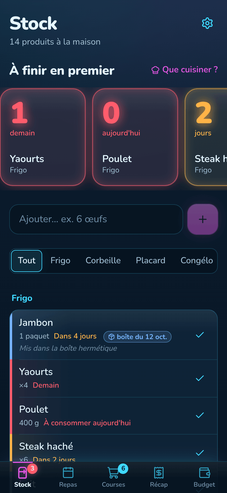 | 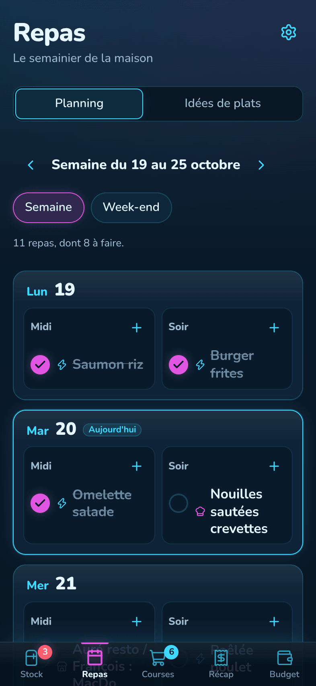 | 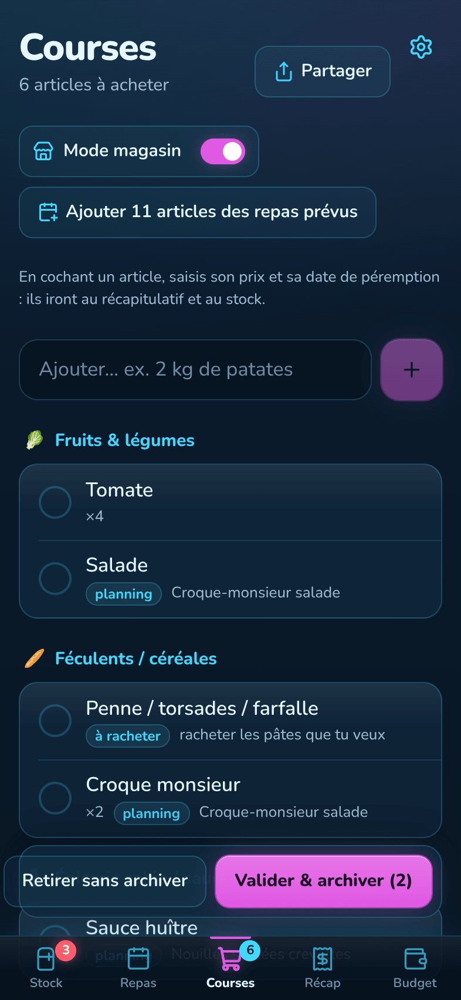 |
| 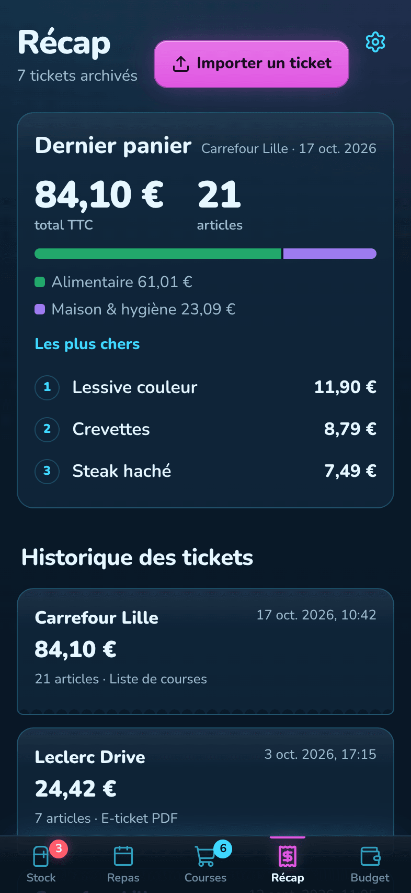 | 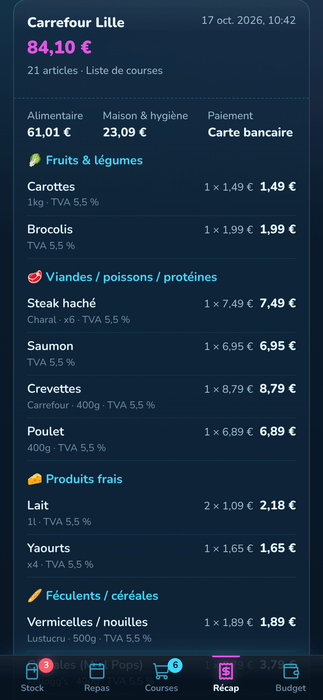 | 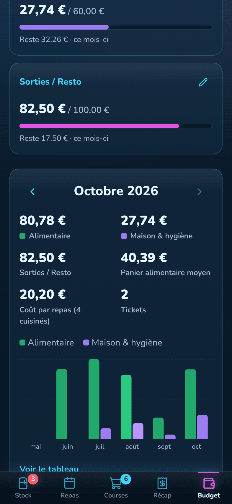 |
| 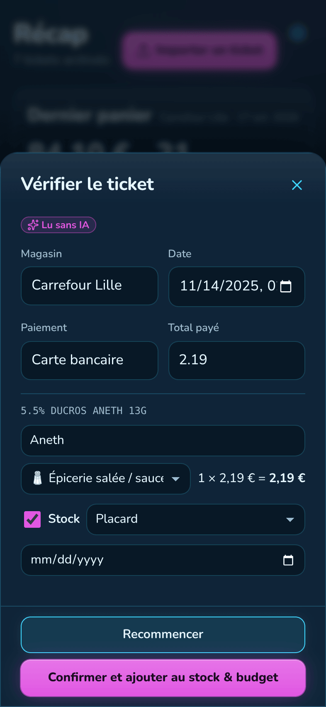 | 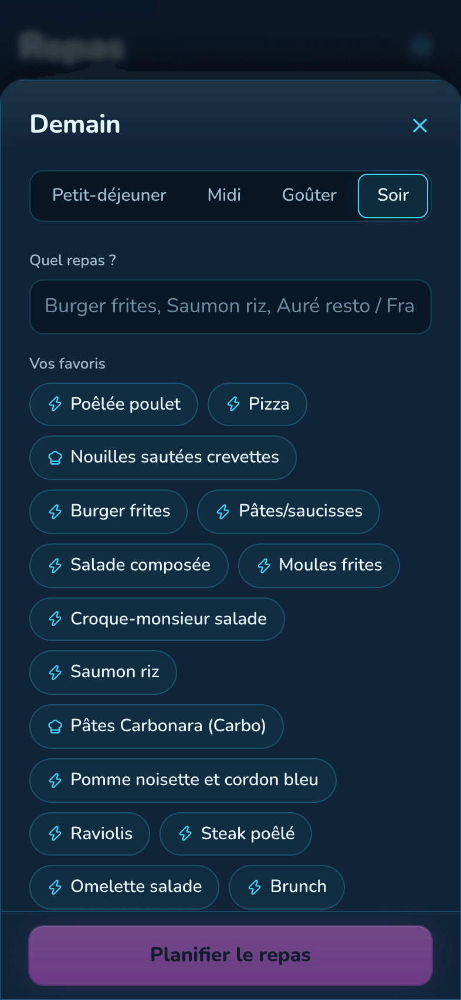 | 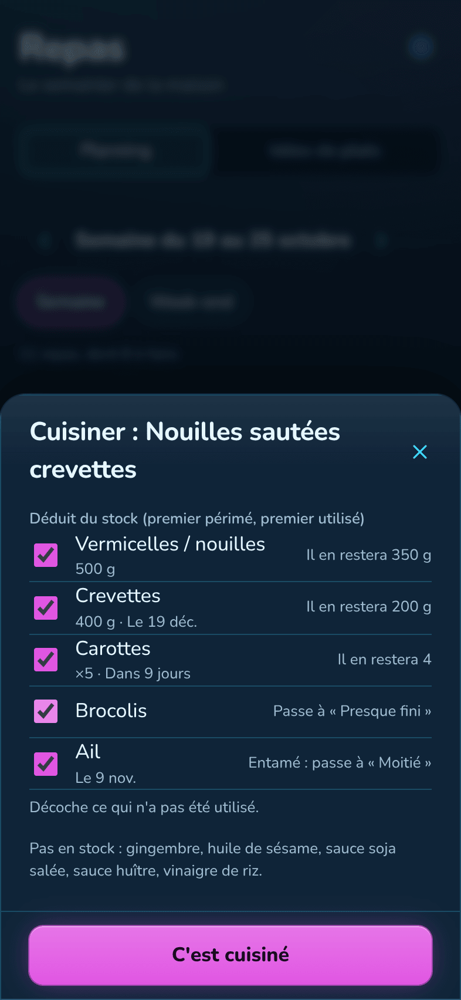 |
| 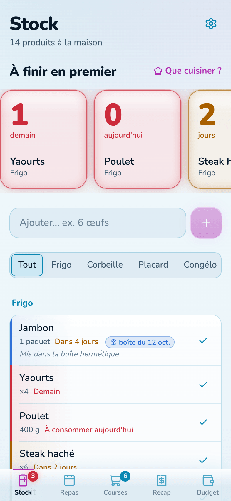 | | |

**Mac**

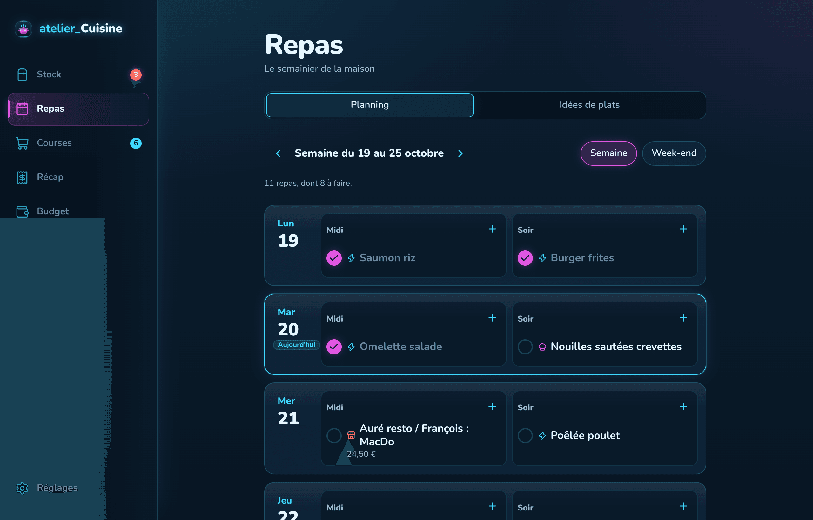
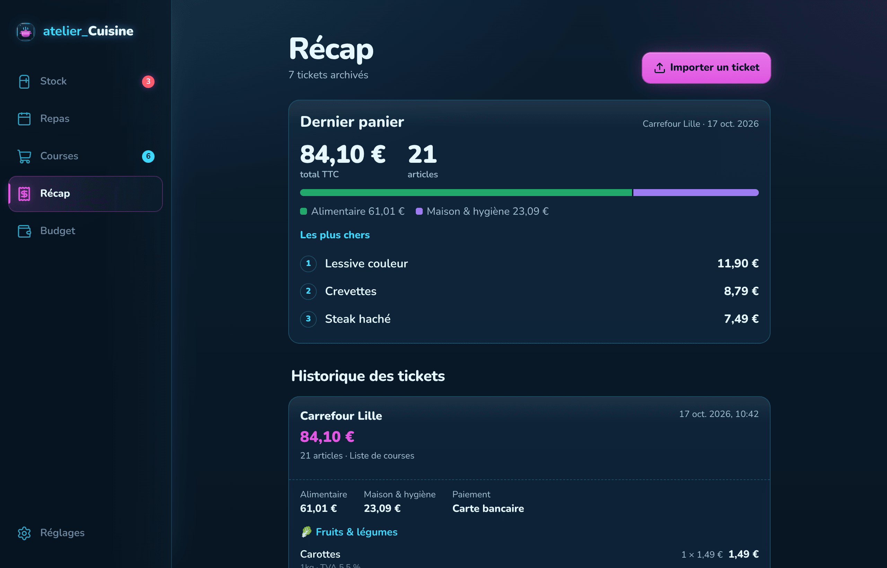
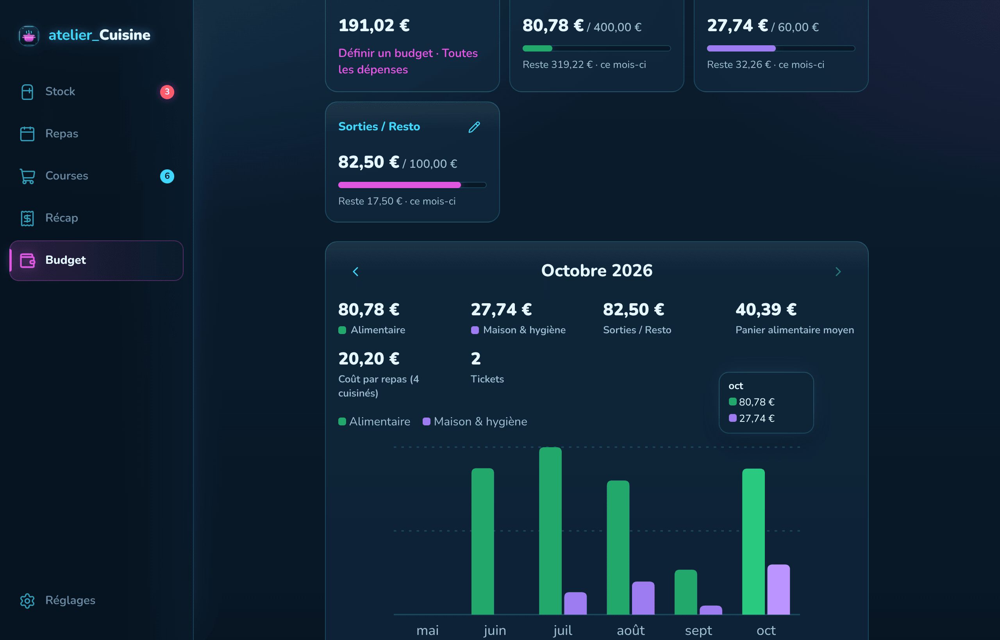
