# Atelier Cuisine — design UI

L'app de cuisine du foyer d'Auré et François : le stock du frigo et des placards, le semainier des repas, la liste de courses, les tickets de caisse et le budget. Utilisée à deux, sur Mac et surtout sur iPhone, en cuisine ou en magasin.

**Tâche principale de l'interface :** montrer d'un coup d'œil ce qu'il faut finir en premier, puis ce qu'on mange et ce qu'on achète.

## Direction : charte v2 « Linear » de la suite Atelier

L'app suit le système commun de la suite (règles complètes : `Atelier_Deploy/DESIGN.md`, contrat : `Atelier_Projets/docs/SUITE.md` §1) : **une structure neutre en gris froids**, la même dans toutes les apps, en clair comme en sombre, plate au repos, traits de 1 px, police Inter. Chaque app garde **sa couleur signature comme seul accent** ; pour Cuisine, la **lavande `#8568a7`** (`--atelier-sig-cuisine`, 4,5:1 avec du texte blanc).

- La lavande ne sert qu'à ce qui a un sens : bouton principal (plein, dans les deux thèmes), sélection (puce pressée, type de repas choisi, case cochée), focus, liens, l'icône de l'app, la courbe des prix et la jauge Sorties / Resto (une seule mesure).
- Pas de halo, de lueur, de grille de fond, de `text-shadow`, de contour lumineux ni de barre de couleur à gauche. Une ombre seulement pour ce qui flotte : feuilles, toasts, bulle du graphique, barre « Valider & archiver ».
- Navigation : l'onglet courant a un fond neutre (`--atelier-surface-3`), jamais de couleur.

### Le kit commun

`frontend/src/styles/atelier-brand/` contient des **copies verbatim** de `Atelier_Projets/design-system/brand/` : `atelier-brand.css` (jetons `--atelier-*`, marque, fenêtre « À propos »), `atelier-theme.js` (préférence de thème commune), `inter-latin-wght-normal.woff2`, `inter-latin-ext-wght-normal.woff2` et `LICENSE-Inter.txt`. Ne jamais les éditer ici : toute modification se fait à la source puis dans chaque copie (ils sont exclus du lint).

- Activation : `<html data-atelier-app="cuisine">` (`frontend/index.html`).
- Thème : choix **Système / Clair / Sombre** dans Réglages → Apparence, branché sur `window.atelierTheme.set(pref)`. `atelier-theme.js` est inséré tel quel en script bloquant au début de `<head>` par `vite.config.ts` ; il pose `data-theme="light|dark"`, `data-theme-pref` et la classe `dark` avant l'affichage, et garde la préférence dans `localStorage["atelier:theme"]` (cookie `atelier_theme` sur le domaine de la suite quand l'app y est servie). L'ancienne préférence (`theme` dans `atelier.reglages`) est reprise une fois puis retirée.
- Barre d'état : un petit script d'`index.html` suit `data-theme` et met `theme-color` à `#fbfbfc` (clair) ou `#0f1012` (sombre), les fonds `--atelier-bg`. Le manifeste PWA et la fenêtre Tauri partent de `#fbfbfc`.

### Jetons de l'app (`tokens.css`)

Les noms de l'app sont branchés sur le kit ; leurs valeurs suivent le thème toutes seules.

| Jeton | Branché sur | Rôle |
|---|---|---|
| `--bg` | `--atelier-bg` | fond de la zone principale |
| `--bg-creux` | `--atelier-sidebar` | barre latérale, barre d'onglets, fond d'un ticket déplié |
| `--surface` | `--atelier-surface` | listes, cartes, feuilles, boutons |
| `--survol` / `--selection` / `--champ-fond` | `--atelier-surface-2` / `-3` / `--atelier-field` | survol et rail des segments ; onglet courant ; champs |
| `--contour` / `--trait` / `--ligne` | `--atelier-border` / `-border-soft` / `-line` | cartes ; champs, boutons, puces ; séparateurs |
| `--encre` / `--encre-2` / `--encre-3` | `--atelier-text` / `-muted` / `-faint` | texte ; secondaire ; méta, icônes au repos |
| `--signature` / `--signature-survol` | `--atelier-signature` / `-hover` | bouton principal, case cochée, focus |
| `--signature-texte` | `--atelier-ink` | lavande en texte ou en icône (liens, numéros d'étapes) |
| `--signature-douce` / `--signature-legere` | `--atelier-signature-soft` / `-faint` | sélection ; ligne du jour dans le semainier |
| `--ombre-flottant` | `--atelier-glow-strong` | ce qui flotte seulement |
| `--frais` / `--bientot` / `--urgent` | inchangés : `#3DDC97` / `#FFB347` / `#FF5C6C` (clair `#12804F` / `#A85F00` / `#CC2B3B`) | fraîcheur (et hausses de prix pour le rouge) |
| `--boite` | inchangé : `#78B4FF` (clair `#2F6FD6`) | produit mis dans une boîte |
| `--data-ali` / `--data-maison` | inchangés : `#22A86B` / `#9D7BF0` (clair `#1A8F5B` / `#7A56D8`) | budgets Alimentaire / Maison & hygiène |

Densité : les jetons `--t-base`, `--t-champ`, `--h-ctrl`, `--h-ctrl-sm`, `--h-row` valent 15 px / 16 px / 44 / 36 / 52 px au téléphone (cibles tactiles, pas de zoom automatique de Safari) et 13 px / 14 px / 32 / 28 / 40 px sur un écran de 860 px et plus avec une souris.

### Couleurs de données

- **Fraîcheur** (spec du foyer) : rouge à moins de 2 jours, orange de 2 à 5 jours, **bleu** pour un produit mis en boîte. Dans les listes, une pastille de 8 px devant le nom et l'échéance en couleur ; un produit frais reste neutre (seuls les états qui demandent d'agir sont colorés). Les tuiles « À finir en premier » sont à peine teintées de la couleur de leur donnée, le chiffre du compte à rebours dans cette couleur.
- **Budget** : vert pour l'Alimentaire (rayons 1 à 9), violet pour Maison & hygiène (rayons 10 et 11), lavande de la signature pour Sorties / Resto. Le graphique a une légende, une bulle au survol et une vue tableau.
- Le vert « à la maison » marque les ingrédients disponibles (recette, jauge des idées). Le rouge ne sert qu'aux alertes et aux hausses de prix.

## Typographie

**Inter** variable, embarquée (aucune requête réseau), variantes `cv11` et `ss03`. Hiérarchie portée par la graisse (400 / 500 / 600). Sur Mac : base 13 px, titre d'écran dans la barre haute en 13 px / 600, titres de section 15 px / 600. Au téléphone : base 15 px, titre d'écran 24 px / 600. Étapes de recette en 17 px, interligne 1,6, numérotées dans une pastille lavande : elles se lisent à un bras de distance. Chiffres tabulaires pour les montants, dates, quantités et le compte à rebours. Les emoji des rayons et des recettes sont des données du foyer (spec), pas des icônes d'interface : toutes les icônes viennent de Lucide.

La marque suit le balisage commun : `button.atelier-brand` > `.atelier-brand__tile` (carré arrondi en dégradé de la lavande, glyphe Lucide `utensils` blanc) + « Atelier » en gris puis « Cuisine ». Un clic ouvre « À propos » (`dialog.atelier-about`). Composant : `frontend/src/components/Marque.tsx`.

## Les 5 onglets

| Onglet | Icône | Contenu |
|---|---|---|
| **Stock** | `Refrigerator` | « À finir en premier » en tuiles avec compte à rebours, saisie en une ligne, produits par emplacement (frigo, corbeille, placard, congélateur, maison) avec niveau rapide, date de l'emballage, mise en boîte et note |
| **Repas** | `Calendar` | semainier Lundi → Dimanche (ou focus week-end) : un jour par ligne, Midi et Soir côte à côte ; trois types de repas (recette, assemblage rapide, extérieur), cases « cuisiné » ; idées de plats et recettes pas à pas dans le même onglet |
| **Courses** | `ShoppingCart` | liste par les 11 rayons, articles proposés depuis le planning, mode magasin (prix et date en cochant), « Valider & archiver » |
| **Récap** | `Receipt` | bilan du dernier panier, historique des tickets dépliables par rayon, import PDF / photo / texte avec vérification |
| **Budget** | `Wallet` | plafonds par périmètre, indicateurs du mois, six mois en barres, évolution des prix |

Mise en page :
- **Mac (≥ 860 px)** : coquille du portail : barre latérale de 232 px (marque en haut, onglets de 30 px, Réglages en pied), barre haute collante de 44 px avec le titre de l'écran, son résumé et son action, contenu sur une colonne de 880 px, lignes de liste de 40 px, feuilles en dialogues centrés.
- **iPhone** : barre d'onglets en bas (pastille grise derrière l'icône courante, zone de sécurité respectée) plutôt que la rangée de pastilles du portail, parce que l'app se tient d'une main en magasin ; Réglages en haut à droite ; feuilles qui montent du bas ; lignes de 52 px.

## Principes

1. **Ce qui presse d'abord.** Tri par date partout, mêmes couleurs de fraîcheur partout, alertes à la même place.
2. **Saisie en une ligne.** « 2 kg de patates » donne quantité, unité, rayon, emplacement et date estimée, grâce au catalogue du foyer.
3. **Chaque action dit ce qu'elle fait.** « Valider & archiver », « C'est cuisiné », « Confirmer et ajouter au stock & budget » ; le toast reprend le même verbe.
4. **On vérifie avant d'enregistrer.** Un ticket lu (avec ou sans IA) passe toujours par une modale de vérification ; une déduction de stock se décoche.
5. **Accessibilité.** Cibles de 44 px au téléphone, anneau de focus lavande visible, contrastes vérifiés sur les deux thèmes, `prefers-reduced-motion` et `prefers-reduced-transparency` respectés.

## Icône

L'icône de l'app est la même partout : carré arrondi (rayon 22 %) en dégradé vertical de la lavande (`#9E88BB` → `#8568A7`), glyphe Lucide `utensils` en trait blanc. Sources dans [`icone/`](icone/) :

- `icone-carre.svg` (copie de `frontend/public/icone.svg`) : favicon, PWA, iPhone. Les PNG se régénèrent avec `cd frontend && npm install --no-save sharp && node scripts/icones.mjs`.
- `icone-mac.svg` et `icone-mac-1024.png` : la même icône sur la grille macOS (carré de 824 px, ombre du système), pour le Dock : `cd frontend && npx tauri icon ../design/icone/icone-mac-1024.png -o src-tauri/icons` (supprimer ensuite les dossiers `android/` et `ios/` générés).

## Captures

Données d'exemple simulées (aucune donnée réelle du foyer).

| iPhone | | |
|---|---|---|
| 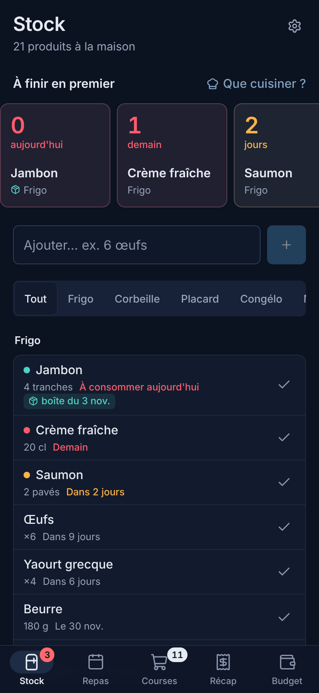 | 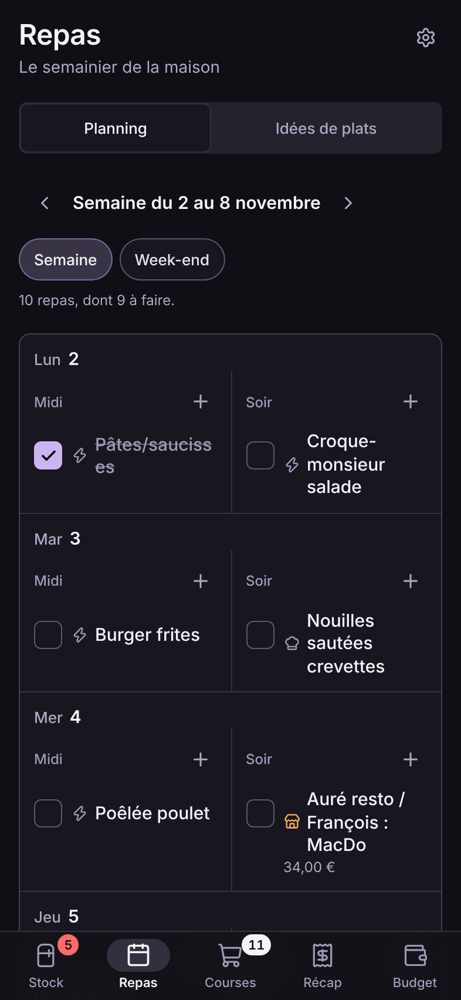 | 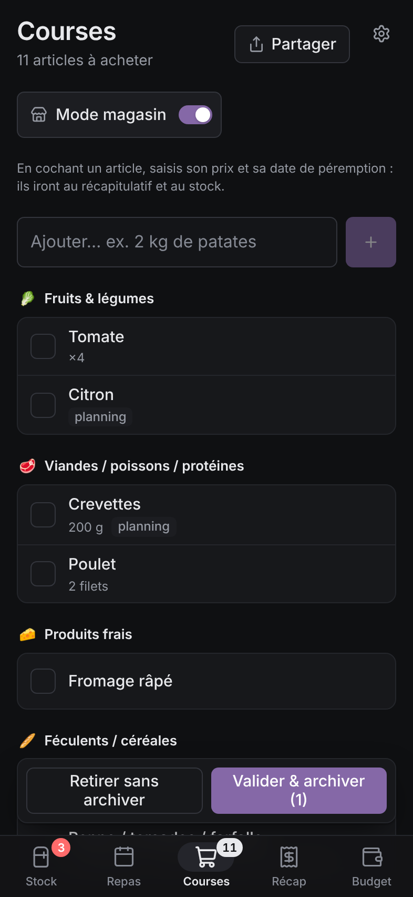 |
| 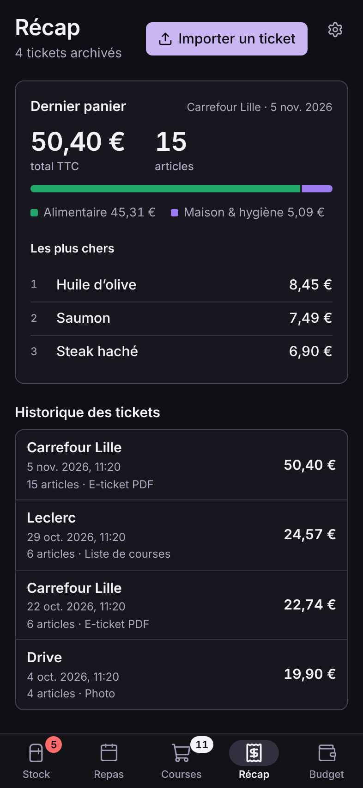 | 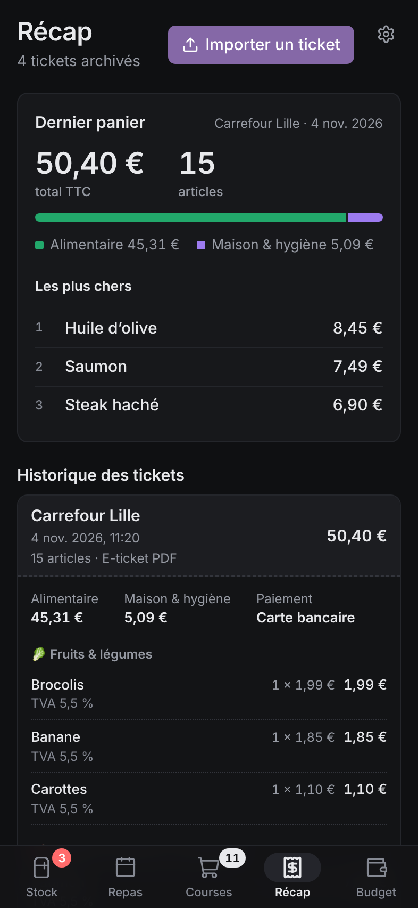 | 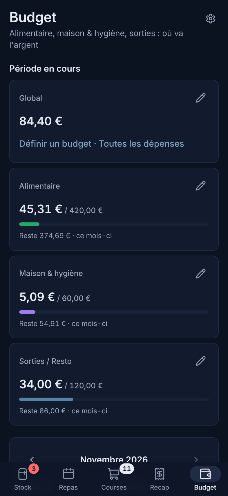 |
| 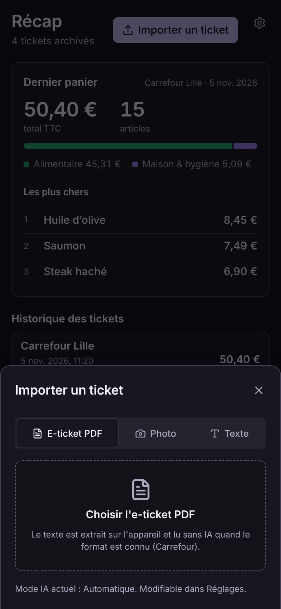 | 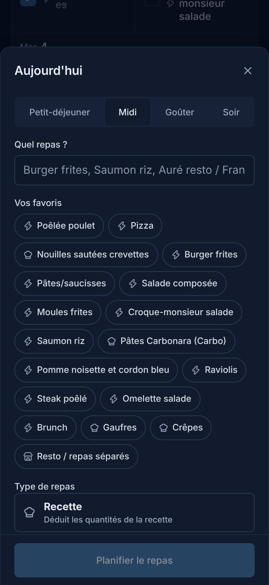 | 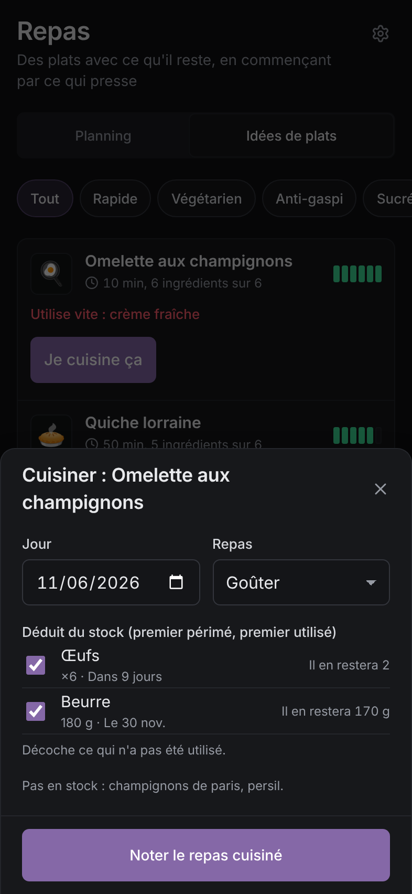 |
| 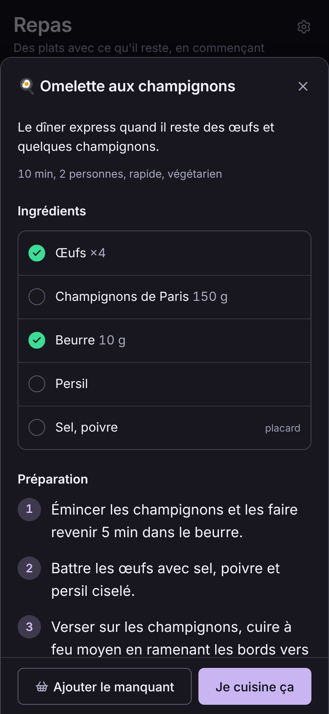 | 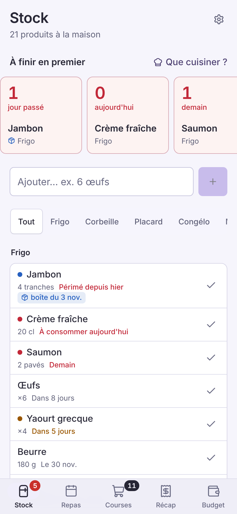 | |

**Mac**

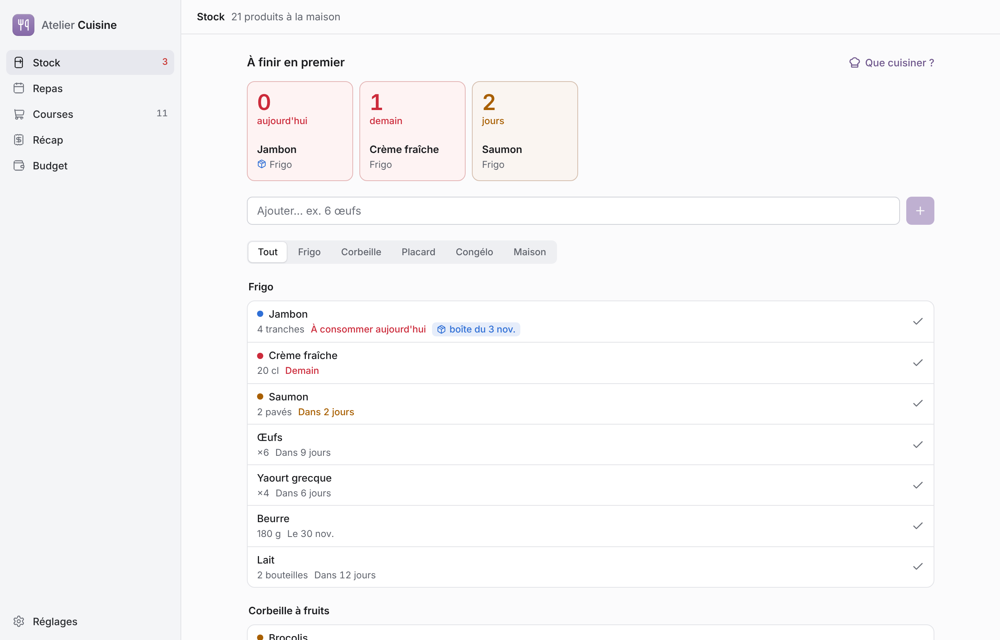
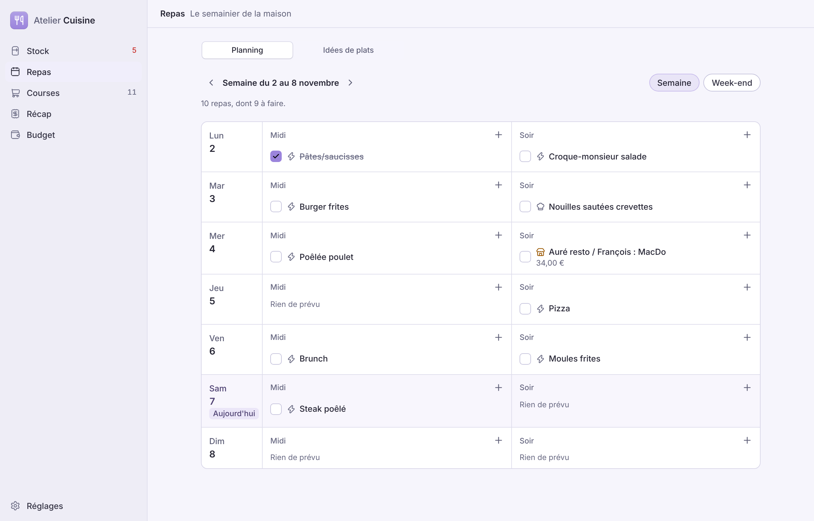
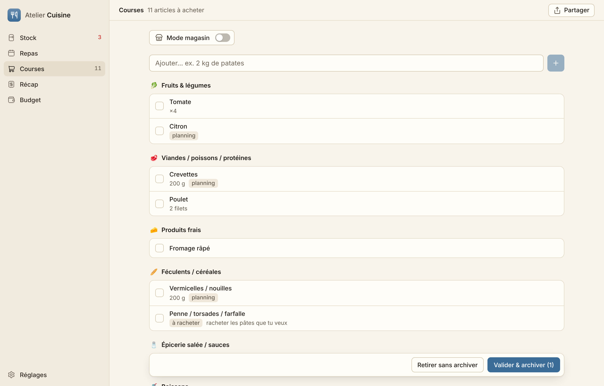
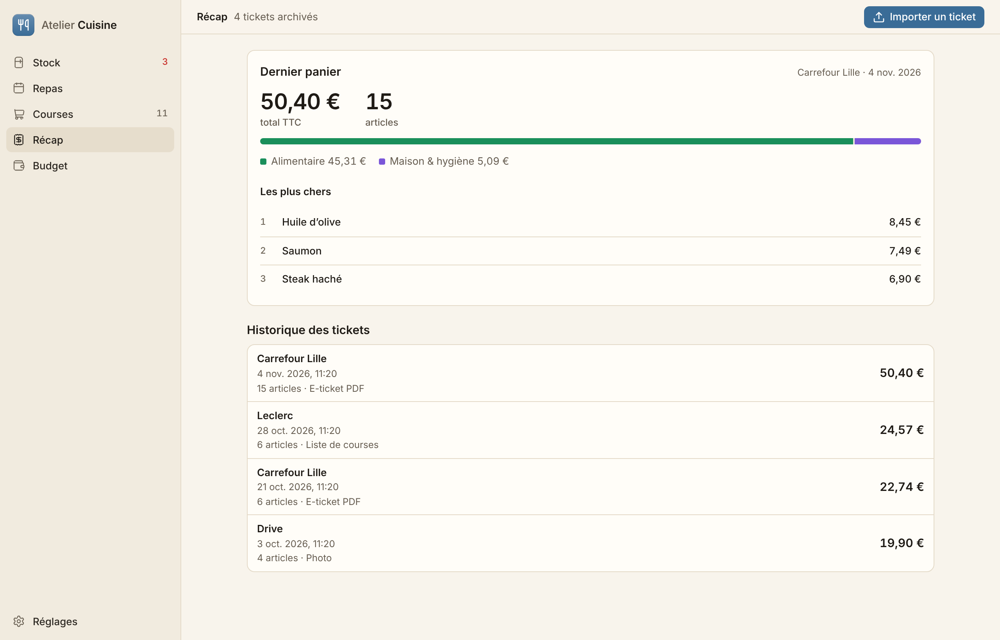
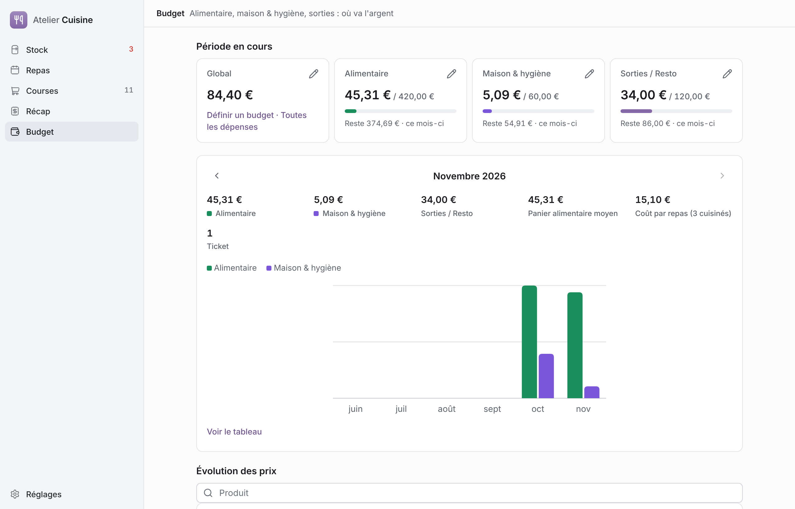
